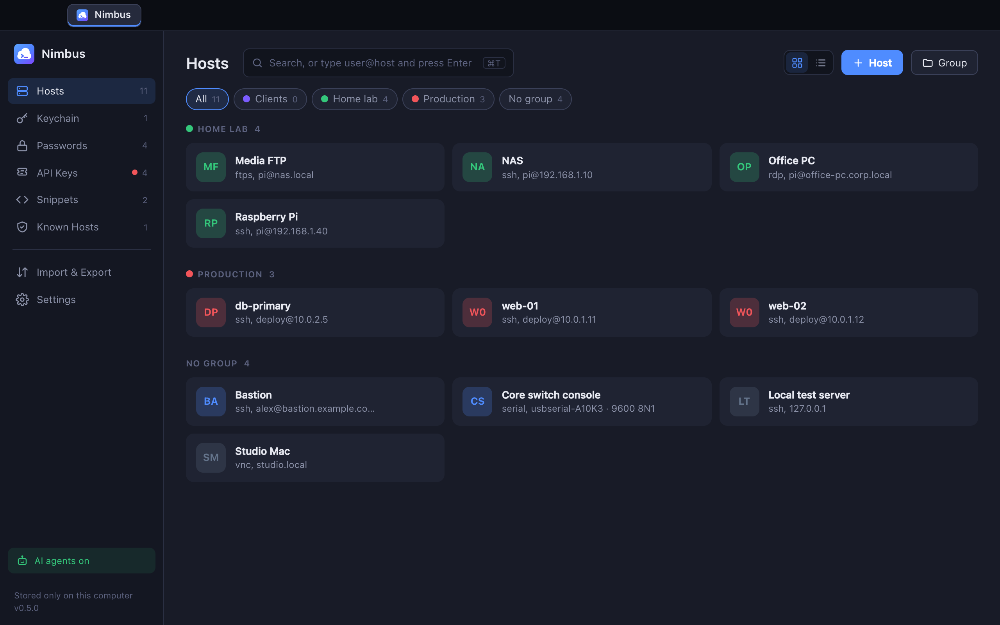

# Nimbus



A simple SSH, SFTP, FTP, serial, Remote Desktop and VNC connection manager, with no cloud,
accounts or vault service. Your hosts live on your computer, and you move them to another
computer with one export file.

Runs natively on **macOS, Windows and Linux** (Tauri: Rust core + the OS's own webview,
~10–15 MB installers).

## Features

- **Hosts and groups**: card grid, or a compact list (the switch by the New Host
  button; Nimbus remembers your choice). Like the Passwords list, the group chips along the top
  filter the list, and "All" shows a section per group. Colours, tags, notes, search.
  Groups can set a default username, port and key for every host inside them (edit a group from
  the pencil by its chip, or right-click a group).
- **Serial consoles**: add a host of type Serial for a router or switch console cable, an Arduino
  or any USB-serial adapter. Pick the port (Scan lists what's plugged in), baud rate, data bits,
  parity, stop bits and flow control, what Enter sends (CR / LF / CR LF) and local echo. It opens
  in a terminal tab with a **Break** button; Snippets and Type password work there too.
  On Linux your user needs to be in the `dialout` group to open serial ports.
- **Remote Desktop (RDP)**: add a host of type RDP for a Windows PC or server, or a Linux desktop
  running xrdp. It opens in a tab like any other connection (and can be pulled out into its own
  window). The remote desktop is resized to fit the tab whenever the window changes size, at
  your screen's full resolution so text stays sharp on Retina / HiDPI displays (turn that off per
  host for slow connections). Sign-in uses Network Level Authentication with the host's saved
  password, and the server's certificate is checked like an SSH host key: trusted the first time,
  flagged if it changes. Text copy and paste works both ways. Rest the pointer at the top edge
  for the toolbar: Ctrl+Alt+Del, the Start key, Type password, full screen and disconnect. On a
  Mac, ⌘ works as Ctrl (⌘C / ⌘V / ⌘Z). Jump hosts work, so a desktop behind a bastion is one
  click. Built on [IronRDP](https://github.com/Devolutions/IronRDP).
- **VNC (screen sharing)**: add a host of type VNC for a Mac (turn on Screen Sharing), a Linux
  desktop (TigerVNC, x11vnc, wayvnc), a Raspberry Pi, or a virtual machine's console (Proxmox,
  QEMU). It works like a Remote Desktop tab: the same toolbar, Type password, copy and paste
  (accents and emoji too, with servers that support the extended clipboard), tabs that move
  between windows. The remote desktop is resized to fit the tab when the server allows it
  (TigerVNC does); otherwise the picture is scaled to fit. Sign-in, best first: VeNCrypt with a
  certificate (encrypted; the certificate is checked like an SSH host key), Apple's sign-in for a
  Mac (user name and password, sent encrypted), or the classic VNC password. Plain VNC isn't
  encrypted, so on untrusted networks connect through a jump host.
- **Quick connect**: type `user@host` or `user@host:port` in the search box and press Enter.
  Start with `sftp://`, `ftp://` or `ftps://` to open the file browser instead, or `rdp://` /
  `vnc://` for a remote desktop.
- **Light and dark themes**: follow the system, or pick one in Settings.
- **Tabs**: many sessions at once. ⌘T home, ⌘W close tab, ⌘1–9 switch, ⌘D duplicate,
  Ctrl+Tab cycle (on Windows and Linux use Ctrl+Shift instead of ⌘). Drag a tab along the tab
  bar to reorder it, or pull it out of the bar to give it its own window, like Chrome; drop it on
  another window's tab bar to put it back. The connection stays up and the scrollback comes along.
- **Authentication**: saved key → SSH agent (ssh-agent, 1Password, Secretive, Pageant)
  → password / keyboard-interactive (2FA prompts work). Anything missing is asked for, with
  an option to save it.
- **Keychain**: add a key from a file, paste one, or generate an Ed25519 key and copy its public
  half to your servers.
- **Jump hosts**: connect through a bastion (chains work too).
- **Known hosts**: you confirm a server's fingerprint the first time, and you're warned
  loudly if it changes later.
- **File browser (SFTP, FTP, FTPS)**: two panes, this computer on the left and the server on the
  right. Drag files and folders between them (or drop them in from Finder / Explorer), double-click
  a file to copy it across, rename, new folder, delete, show hidden files. Transfers show progress
  and can be cancelled. Open it from an SSH host (folder icon, right-click → Open SFTP, the terminal's
  SFTP button, or ⌘⇧O), or add an FTP / FTPS host, which opens straight into the file browser.
  - SFTP uses the host's normal SSH login, keys and jump hosts.
  - FTPS uses explicit TLS. A certificate your computer doesn't recognise (self-signed, as on most
    NAS boxes) is shown once to trust, like an SSH host key, and you're warned if it changes.
  - Deleting on this computer moves things to the Trash / Recycle Bin. Deleting on the server is
    permanent and asks first.
- **Passwords**: a simple password manager in a list view. Store name / username / password /
  website / notes, sort them into coloured groups, generate strong passwords, show or copy them
  (the clipboard clears itself after 30 s), search, and click a website or address to open it.
- **API Keys**: a home for API credentials, Postman-style. Each one has a type (API key, Bearer
  token, Basic auth, OAuth 2.0 client credentials, or Custom fields), a service, an environment
  (Production / Staging / Development…), a group, a base URL, an expiry date and notes. Secret
  fields are encrypted like passwords; add your own extra fields and choose which are secret.
  Copy the key on its own, or **Copy as** an Authorization header, a curl command, `.env` lines or
  JSON. Expired and soon-to-expire credentials are flagged.
- **Type password into a session**: the terminal's **Password** button (or ⌘⇧P / Ctrl+Shift+P)
  types the host's saved password, or any Passwords entry, as keystrokes and presses Enter.
  Use it at a `sudo` prompt. The password goes straight from the encrypted store to the SSH
  connection, never through the UI or the clipboard. Turn off the automatic Enter in Settings.
- **Snippets**: saved commands you can paste into any terminal from the Snippets button.
- **Import `~/.ssh/config`**: picks up Host, HostName, User, Port, IdentityFile and ProxyJump.
- **Export / import**: one file with hosts, groups, keys, passwords, API credentials, snippets and
  trusted host keys / certificates. Exports are always encrypted with a password you choose
  (scrypt + AES-256-GCM over the whole file, so not even host names are readable), and that
  password is needed to import. A forgotten export password can't be recovered.
- **AI agents (MCP)**: let Claude Code, Claude Desktop, Grok, Cursor or any MCP client run
  commands on your hosts and call APIs with your saved credentials. Turn it on in
  **Settings → AI agents**, then add one agent per app. See [AI agents](#ai-agents-mcp) below.
- **Links** (password and API websites, links in the terminal with ⌘/Ctrl-click) open in your
  default browser; Nimbus never loads outside pages in its own window.

## AI agents (MCP)

Nimbus can act as an [MCP](https://modelcontextprotocol.io) server, so AI agents can work on your
machines without ever being handed your passwords or keys. It's off until you turn it on.

**Setting up:** Settings → AI agents → tick *Allow AI agents to connect*, then **+ Agent**. Nimbus
shows the agent's token once, with ready-to-paste setup for:

- **Claude Code**: `claude mcp add --transport http nimbus http://127.0.0.1:47821/mcp --header "Authorization: Bearer <token>"`
- **Claude Desktop, Cursor and other apps that start a command**: the Nimbus app itself with
  `--mcp` and the token in `NIMBUS_MCP_TOKEN` (a stdio bridge to the running app).
- **Anything else** (Grok, scripts): Streamable HTTP at `http://127.0.0.1:47821/mcp` with an
  `Authorization: Bearer <token>` header.

Then choose what the agent can use: single hosts, passwords and API credentials, or whole groups
(which include anything added to them later).

**What an agent can do**

| Tool | What it does |
|---|---|
| `list_hosts`, `list_credentials` | See what it's been granted: names, addresses, usernames, URLs. Never notes or secret values. |
| `run_command` | Run a command on a granted SSH host and get the output. Nimbus logs in with the saved key or password. With `sudo`, Nimbus types the host's saved password at sudo's prompt. |
| `http_request` | Call an API with a granted credential. Nimbus adds the API key, token, Basic auth or OAuth client-credentials token, only for the credential's own site, and scrubs the secret from the reply. |
| `get_secret` | Only if you allow it for that agent: ask to see a secret value. You approve every single one. |

**How it's kept safe**

- Listens on 127.0.0.1 only, and refuses requests from web pages or other host names.
- Each agent has its own random token; Nimbus stores only a hash of it. Pause an agent, make a new
  token, or remove it at any time.
- By default every command and API request waits for you to click **Allow** in Nimbus (the window
  comes to the front). You can choose "Allow for 30 min" for one host or credential, or set an
  agent to run without asking.
- Agents can't change anything in Nimbus, can't trust a new host key, and can't answer login
  prompts. Connect to a host once yourself first.
- An API credential only works against its own base URL (no sending your key to another site,
  no https → http, no following redirects).
- Everything an agent does is in Settings → AI agents → Recent activity (also
  `mcp-activity.log` in the data folder). Agent access is never included in exports.

What it can't protect against: an agent you've set to "allow without asking" can run anything on
the hosts you gave it, and once you approve `get_secret` the agent has that value.

## Where data is stored

| | macOS | Windows | Linux |
|---|---|---|---|
| Folder | `~/Library/Application Support/app.nimbus.ssh` | `%APPDATA%\app.nimbus.ssh` | `~/.local/share/app.nimbus.ssh` |

- `nimbus-data.json`: hosts, groups, public keys, snippets, password and API key names, known
  hosts, settings, AI agents and their access (plain JSON, no secrets; agent tokens only as hashes)
- `mcp-activity.log`: what AI agents did (no secret values)
- `secrets.bin`: passwords, private keys, passphrases and API secrets, encrypted with AES-256-GCM. The
  encryption key is held in the OS keychain (Keychain / Credential Manager / Secret Service).
  If no keychain is available, it falls back to a local `master.key` file and the app says so.

To move to a new computer, use **Import & Export**. Don't copy `secrets.bin` by hand, because
its key stays in the old computer's keychain.

## Develop

Needs Node 20+ and Rust (`rustup`). On Linux, also install the
[Tauri system packages](https://tauri.app/start/prerequisites/) (webkit2gtk etc.).

```sh
npm install
npm run tauri dev          # run the app
npm run dev                # UI only, in a browser, with a fake backend (src/dev-mock.js)
npm run tauri build        # installer for the current OS (.dmg / .msi+.exe / .deb+.AppImage)
```

Each OS's installer has to be built on that OS. `.github/workflows/build.yml` builds them all on
GitHub (push a `v*` tag): macOS (Apple Silicon and Intel), Windows, Linux x86-64 and Linux ARM64.

### Linux ARM64 (Steam Frame and other ARM devices)

```sh
npm run build:linux-arm64   # needs Docker; output in dist-linux-arm64/
```

This builds inside an ARM64 Ubuntu 22.04 container: natively on an Apple Silicon Mac, emulated
(slower) elsewhere. You get an `.AppImage`, a `.deb` and an `.rpm`.

On a **Steam Frame** (SteamOS, Snapdragon, ARM64): switch to Desktop Mode, copy the `.AppImage`
over, make it executable (right-click → Properties → Permissions, or `chmod +x`), and run it.
The AppImage carries its own copy of the web view, so nothing needs installing. To use a USB
serial adapter on Linux, your user needs to be in the `dialout` group.

Scripted UI checks: a debug build runs the JavaScript file in `NIMBUS_DEV_SCRIPT` in every
window, and can report back with the `dev_log` command (printed to stderr). Use it with a throwaway
`NIMBUS_DATA_DIR`.

Backend tests (`src-tauri/src/tests.rs`). The FTP and FTPS tests start their own FTP server
inside the test. The SSH and SFTP tests run against a real `sshd` on 127.0.0.1:2222 (with
`Subsystem sftp internal-sftp`) when `NIMBUS_TEST_SSHD` points at a folder with the test keys
`client` and `client_enc` (passphrase `secretpass`):

```sh
cd src-tauri && NIMBUS_TEST_SSHD=/path/to/keys cargo test
```

The Remote Desktop tests run against the xrdp container in `src-tauri/tests/xrdp` (see the top of
its Dockerfile) when `NIMBUS_TEST_RDP=127.0.0.1:3390` is set; with `NIMBUS_TEST_SSHD` too, they
also connect through the SSH test server as a jump host. The VNC tests run against the TigerVNC
container in `src-tauri/tests/vnc` when `NIMBUS_TEST_VNC=127.0.0.1` is set.

The agent `sudo` test also needs a second sshd on 127.0.0.1:2223 whose `PATH` starts with a fake
`sudo` that accepts `hunter2-sudo` (`SetEnv PATH=...` in its config); set `NIMBUS_TEST_SUDO=1`.

## Layout

```
src/                 UI (vanilla JS + xterm.js)
  main.js            views, editors, tabs, shortcuts
  terminal.js        one terminal tab ↔ one SSH session (tabs can move between windows)
  files.js           one file browser tab (local pane + SFTP/FTP pane, transfers)
  desktop.js         one Remote Desktop or VNC tab (canvas, keyboard and mouse, toolbar)
  prompts.js         host-key / password / 2FA dialogs
src-tauri/src/       Rust core
  ssh.rs             connect, host-key check, auth, jump hosts, PTY pump (russh)
  files.rs           local disk, SFTP and FTP/FTPS browsing and transfers
  mcp.rs             AI agent (MCP) server, approvals, stdio bridge
  serial.rs          serial port sessions
  desktop.rs         what Remote Desktop and VNC share: streaming the screen, input, tunnels
  rdp.rs             Remote Desktop sessions (IronRDP): sign-in, screen updates, resize, clipboard
  vnc.rs             VNC sessions: sign-in, the decoders (Tight, ZRLE, Hextile…), resize, clipboard
src/apikeys.js       API credential types and "Copy as" formats
docker/, scripts/    the Linux ARM64 build
  store.rs           data model + persistence
  vault.rs           at-rest encryption + export passphrase encryption
  transfer.rs        export / import file
  sshconfig.rs       ~/.ssh/config import
  keys.rs            read / generate private keys
```

## Not yet

- Remote Desktop: sound, drive and printer redirection, multiple monitors, RD Gateway, and the
  H.264 graphics pipeline (screen updates use RemoteFX and bitmap codecs today).
- VNC: newer macOS sign-in types (when the Mac offers only those), anonymous-TLS VeNCrypt,
  file transfer, sound.
- Port forwarding, agent forwarding, split panes, editing a remote file in place.

## License

MIT. See [LICENSE](LICENSE).
